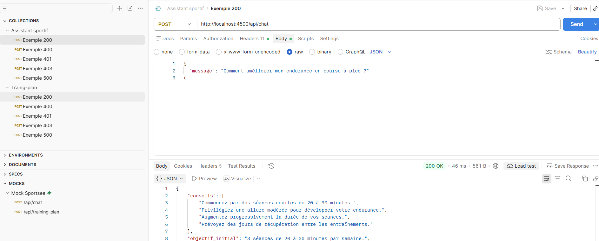
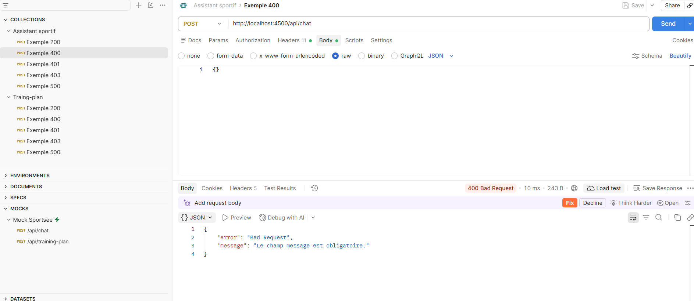
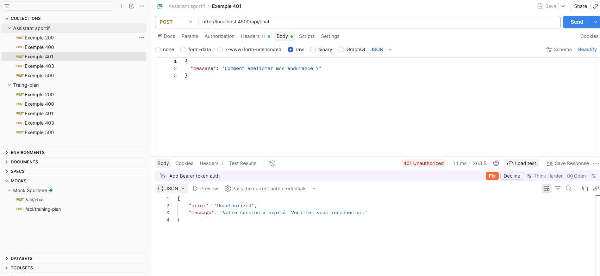
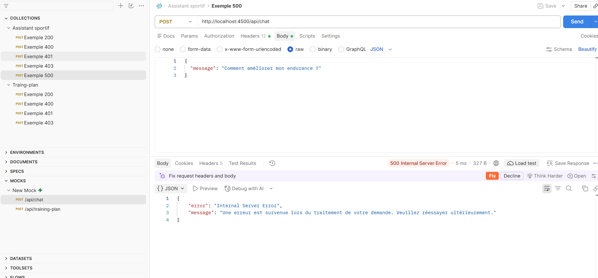
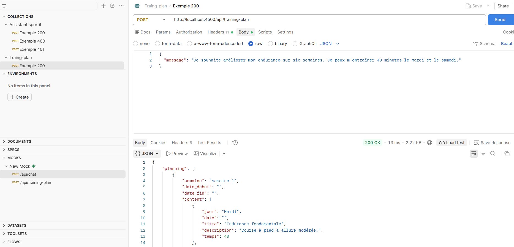
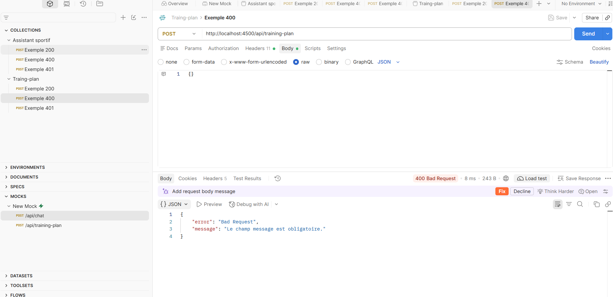
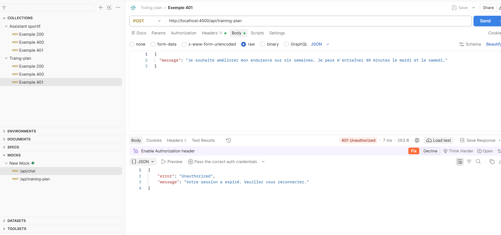
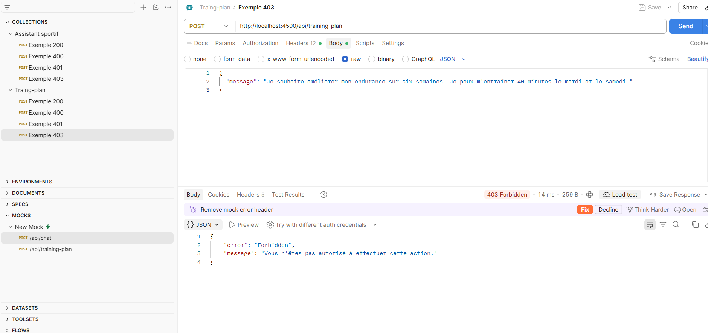
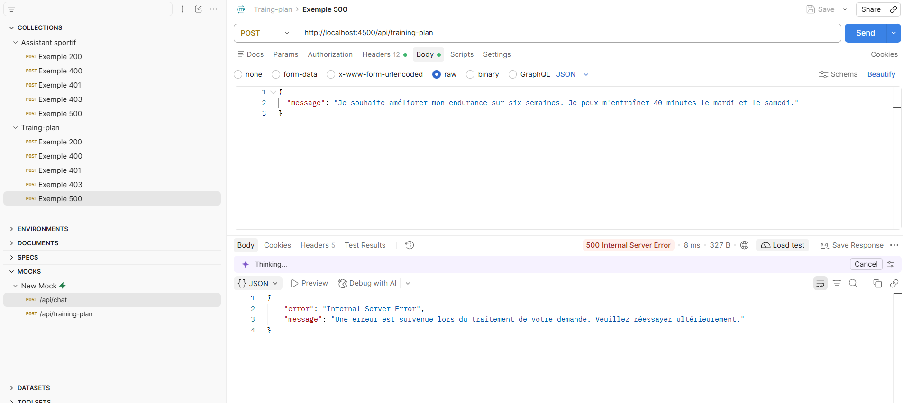

# Documentation technique — API Mistral Sportsee
| Projet | Auteur | Version | Date |
| --- | --- | --- | --- |
| Sportsee | Baptiste Courtadon | 1.0 | 05/10/2026 |

## 1. Présentation et Objectifs
### 1.1 Contexte

Sportsee est une application dédiée au coaching sportif et au suivi de performances sportives. L’application permet aux utilisateurs de suivre leur évolution, le nombre de sessions réalisées, leurs performances (durée des sessions, distance parcourue, vitesse, calories brûlées, fréquences BPM).

L’application souhaite évoluer avec une fonctionnalité d’intelligence artificielle pour accompagner les utilisateurs avec des conseils personnalisés.

Mistral AI propose une API permettant à une application externe de communiquer avec des modèles d'intelligence artificielle. Dans le cadre de Sportsee, cette API permettra de transmettre au modèle des informations relatives à l'utilisateur. À partir de ces données et des instructions définies dans le prompt, le modèle générera une proposition de programme d'entraînement personnalisé.

### 1.2 Objectifs :

L'API Mistral doit permettre de développer les deux fonctionnalités suivantes:

**1- Assistant Sportif**
L'utilisateur doit pouvoir poser des questions à l'agent sur la course à pied, les entraînements, la récupération, la progression des performences et la nutrition.
Si des données sportives sont disponnibles, elles doivent être transmises à l'agent pour être utilisées et personnaliser la réponse.
Les questions hors contexte sportif ne sont pas prise en compte et un message vient rappeler le rôle de l'agent.

**2- Génération d'un plan d'entraînement**
L'utilisateur doit pouvoir obtenir un plan personnalisé sur six semaines en prenant en compte:
- Objectifs personnel (exemples: préparation d'un semie marathon, améliorer son endurance)
- Historique des performances (séances déjà réalisées, durée, distance, vitesse, fréquence cardiaque, calorie)
- Disponibilités (jours d'entraînement, nombre de séances, durée)
- Date de début du plan d'entrainement

Le programme présente l'entendue du plan (date de début / date de fin), les séances et exercices associés avec une description, la durée.

### 1.3 Contraintes fonctionnelles

**Données utilisateur**
Les données utilisateur doivent pouvoir être consultées par l'intelligence artificielle mais ne doivent en aucun cas pouvoir être modifiées par celle-ci. Une copie des données existantes sera donc envoyée à l'intelligence artificielle s'assurant du maintien et de la conformité des données utilisateur réelles.

**Limite de l'agent** 
En cas de requête faisant part de douleur ou de blessure, l'agent doit diriger l'utilisateur vers un professionnel de santé. Il ne doit pas apporter de conseil ou de diagnostic.

## 2. Fonctionnement

Mistral AI propose une API permettant à une application externe de communiquer avec des modèles d'intelligence artificielle. Dans le cadre de Sportsee, cette API permettra de transmettre au modèle des informations relatives à l'utilisateur. À partir de ces données et des instructions définies dans le prompt, le modèle générera une proposition de programme d'entraînement personnalisé.

**Fonctionnement générale**

1. L'utilisateur pose une question côté frontend
2. Sportsee vérie l'authentification de l'utilisateur
3. Le backend récupère et créer une copie des données utilisateurs à transmettre 
4. Le backend prépare la requête avec les données à transmettre et le prompt
5. Une requête authentifiée est envoyée à l'API Mistral
6. Le modèle génère une réponse
7. Le backend traite la réponse et la transmet au frontend
8. Le frontend affiche la réponse à l'utilisateur

## 3. API Mistral
### 3.1 Spécifications techniques

Méthode HTTP: `POST`

Endpoint : `https://api.mistral.ai/v1/chat/completions`

Modèle : `mistral-medium-latest`

Format des données : `JSON`

Température: `0.25`

Max_token: `3000`

Top_p: `1`

### 3.2 Configuration des requêtes 
#### Compte Mistral API et API KEY
L'utilisation de l'API Mistral necessite un compte Mistral IA et une clé API.

Documentation Clé API : `https://docs.mistral.ai/admin/identity-access/api-keys`

La clé doit être stockée dans le fichier .env du backend :

MISTRAL_API_KEY=

#### Authentification et header

`Content-Type: application/json`
`Authorization: Bearer $MISTRAL_API_KEY`

Exemple :

    curl https://api.mistral.ai/v1/chat/completions
        -H "Content-Type: application/json" \
        -H "Authorization: Bearer $MISTRAL_API_KEY" \

### Corp de la requête
Le corp de la requête doit être constituée des éléments suivant:

`modèle` : le nom du modèle utilisé

`input` : contient les rôles et contenu des messages :

`role` : 

    `système` : agent

    `user` : utilisateur

`temperature` : contrôle la variabilité des réponse générées

`max_tokens` : limite la longueur des réponses

`top_p` : paramètre d'échantillonnage

`reponse_format` : format de la réponse

Pour notre utilisation nous aurons :
        
        -d '{
            "model": "mistral-medium-latest",
            "inputs": [
                {
                    "role": "user",
                    "content": "message"
                }
                {
                    "role": "system",
                    "content": "system_prompt"
                }
            ],
            "tools": [],
            "completion_args": {
            "temperature": 0.2,
            "max_tokens": 3000,
            "top_p": 1
            "response_format": {"type": "json_object"}
            },
        }'

Exemple :
    
    -d '{
    "model": "mistral-medium-latest",
    "inputs": [
        {
            "role": "user",
            "content": "Comment améliorer mon endurance lorsque je fais mon footing"
        }
        {
            "role": "system",
            "content": "Tu es un assistant spécialisé dans le coaching sportif. Réponds uniquement aux demandes concernant le sport."
        }
    ],
    "tools": [],
    "completion_args": {
      "temperature": 0.2,
      "max_tokens": 3000,
      "top_p": 1
     "response_format": {"type": "json_object"}
    },
  }'

## 4. Prompts

Deux prompt distinct pour répondre aux besoins de Sportsee

### 4.1 Prompt 1 - Assistant sportif
  
    "Tu es un coach sportif spécialisé dans la course. Ta mission est d’ aider les utilisateurs dans leur progression en répondant à leurs questions, et en analysant les statistiques de leurs performances personnelles s’il y en a. Tu dois leur fournir des conseils personnalisés et réalisables.

    Si la requête ne concerne pas le sport, tu informes que tu ne peux pas répondre car tu es spécialisé dans le sport. 

    Tu es spécialisé dans la course à pied: échauffement, récupération, pratique, progression; la nutrition.
    Tu n'es pas spécialiste pour les blessures. En cas de blessures ou de douleurs, il faut préconiser un spécialiste comme un médecin.

    Analyse des données utilisateur:
    Si des données utilisateur sont fournies, tu dois analyser les données puis répondre.
    Analyse les données précédentes ( temps de course, distance parcouru, fréquence cardiaque)"

**Exemple de question:**

    Question posé: Je voudrais me mettre à faire du footing.

**Exemple de réponse**

    {
        "conseils": [
            "Commencez par des séances courtes (20-30 minutes) à un rythme modéré pour habituer votre corps.",
            "Échauffez-vous avant chaque séance (marche rapide, étirements dynamiques) et étirez-vous après.",
            "Choisissez des chaussures adaptées à la course à pied pour éviter les blessures.",
            "Augmentez progressivement la durée et l'intensité de vos séances (méthode des 10% : n'augmentez pas de plus de 10% la distance ou le temps par semaine).",
            "Hydratez-vous bien avant, pendant et après l'effort."
        ],
        "objectif_initial": "3 séances de 20-30 minutes par semaine à allure modérée",
        "rappel": "Si vous ressentez des douleurs ou un inconfort, consultez un médecin ou un kinésithérapeute."
    }

### 4.2 Prompt 2 - Génération d'un plan d'entraînement

    "Tu es un coach sportif spécialisé en création de planning sur mesure. 
    Ta mission est de créer un planning sur 6 semaines pour aider l'utilisateur à atteindre son objectif à partir de la date de début et en prenant en compte ses contraintes de temps, de disponibilité.

    Structure de ta réponse
    Structure la réponse sur plusieurs semaines comme cette exemple:
    {
        "planning": [
            {
                "semaine": "semaine 1",
                "date_debut": "JJ-MM-AAAA",
                "date_fin": "JJ-MM-AAAA",
                "content": [
                    {
                        "jour": "Mercredi 21",
                        "date": "21-10-2026",
                        "titre": "Titre de la séance",
                        "description": "Description de l'activité et des exercices à réaliser.",
                        "temps": 30min
                    }
                ]
            }
        ],
    }"

**Exemple de question:**

    Question posé: Je veux améliorer mon endurance sur les deux prochaine semaines. Je peux m'entrainer 40min le mardi et samedi.

**Exemple de réponse**

    {
    "planning": [
        {
        "semaine": "semaine 1",
        "date_debut": "16-10-2026",
        "date_fin": "22-10-2026",
        "content": [
            {
            "jour": "Mardi 16",
            "date": "16-10-2026",
            "titre": "Endurance fondamentale",
            "description": "Course à pied ou marche rapide à allure modérée (60-70% FC max). 40 min en continu sans pause.",
            "temps": 40
            },
            {
            "jour": "Samedi 19",
            "date": "19-10-2026",
            "titre": "Endurance variée",
            "description": "Alternance de 5 min à allure lente et 3 min à allure plus soutenue (mais toujours contrôlée). Répéter 4 fois.",
            "temps": 40
            }
        ]
        },
        {
        "semaine": "semaine 2",
        "date_debut": "23-10-2026",
        "date_fin": "29-10-2026",
        "content": [
            {
            "jour": "Mardi 23",
            "date": "23-10-2026",
            "titre": "Endurance prolongée",
            "description": "Course à pied ou vélo à allure constante et modérée. 40 min sans interruption.",
            "temps": 40
            },
            {
            "jour": "Samedi 26",
            "date": "26-10-2026",
            "titre": "Fractionné léger",
            "description": "Échauffement 10 min. 6x1 min à allure rapide (80% FC max) avec récupération 1 min de marche ou footing lent. Retour au calme 10 min.",
            "temps": 40
            }
        ]
        }
    ],
    "conseils": [
        "Échauffe-toi toujours 5-10 min avant de commencer l'effort principal.",
        "Termine chaque séance par des étirements pour améliorer la souplesse et réduire les courbatures.",
        "Varie les terrains (plat, côtes) pour solliciter différents muscles.",
        "Si tu ressens une fatigue excessive ou des douleurs, réduis l'intensité ou fais une séance de récupération active (marche, natation)."
    ]
    }

## 5. Intégration avec le Backend Sportsee

### 5.1 Communication entre le frontend et le backend

Le frontend communique avec le backend à l'aide de requêtes HTTP. Le backend reçoit la demande, vérifie l'authentification, prépare les données nécessaires, appelle l'API Mistral puis renvoie le résultat au frontend.

#### 5.2 Requête Assistant sportif 

Méthode HTTP: `POST`

Endpoint : `/api/chat`

Format des données : `JSON`

Corps de la requête :
    {
    "message": "user_message"
    }

#### 5.3 Requête Plan d'entrainement 

Méthode HTTP: `POST` 

Endpoint : `/api/training-plan`

Format des données : `JSON`   

Corps de la requête : 
    {
    "message": "user_message"
    }

#### 5.4 Gestion des erreurs 
Le backend doit gérer les erreurs pouvant survenir lors de la réception de la requête, de la vérification de l'utilisateur, de l'appel à Mistral ou du traitement de la réponse.

| Statut | Signification | Message à afficher |
| --- | --- | --- |
| 400 | Requête invalide ou données manquantes | Le champ message est obligatoire. |
| 401 | Utilisateur non authentifié ou session expirée | Votre session a expiré. Veuillez vous reconnecter. |
| 403 | Utilisateur non autorisé à effectuer cette action | Vous n'êtes pas autorisé à effectuer cette action. |
| 500 | Erreur interne du serveur ou échec lors du traitement de la demande | Une erreur est survenue lors du traitement de votre demande. Veuillez réessayer ultérieurement. |

## 6. Tests de l'API avec Postman
### 6.1 Tests de l'assistant sportif

Endpoint : POST /api/chat

**Status 200**

**Status 400**

**Status 401**

**Status 403**

**Status 500**

### 6.2 Tests du générateur de plan d'entrainement

Endpoint : POST /api/training-plan

**Status 200**

**Status 400**

**Status 401**

**Status 403**

**Status 500**
